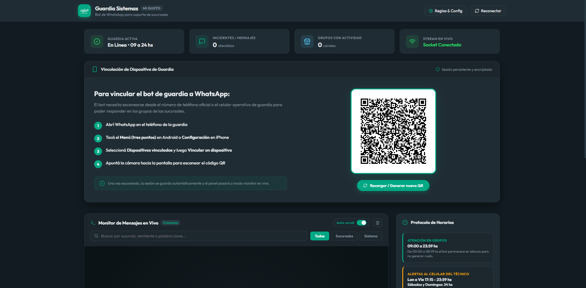
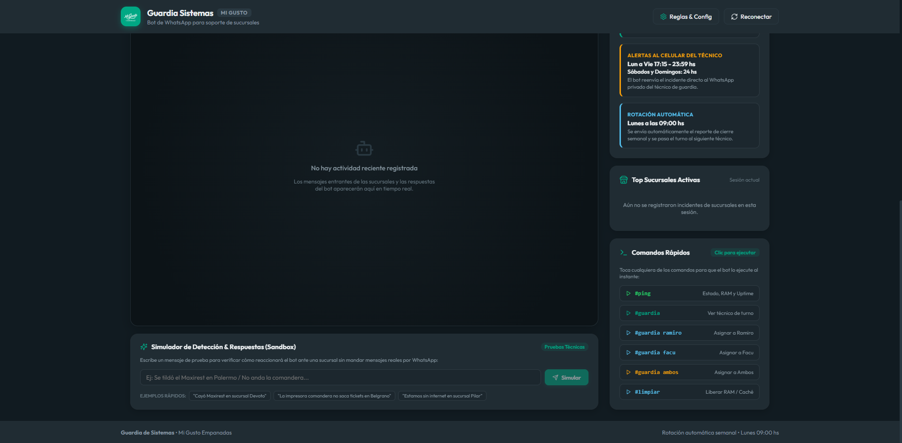
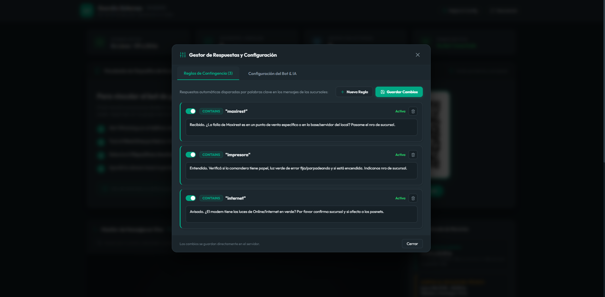

<div align="center">

  

  # 🤖 Guardia Sistemas • WhatsApp Bot & Dashboard
  
  **Plataforma operativa de soporte técnico automatizado y monitor en tiempo real para sucursales de Mi Gusto.**

  <p align="center">
    
    
    
    
    
  </p>

</div>

---

## 📌 Descripción del Proyecto

**Guardia Sistemas** es una solución integral desarrollada para el equipo de IT de **Mi Gusto Empanadas**. El sistema centraliza y automatiza la atención de emergencias técnicas provenientes de más de 40 sucursales en CABA y GBA a través de grupos de WhatsApp, combinando:

- **Atención Humana Simulada:** Respuestas escalonadas con simulación de tipeo y contacto privado inmediato.
- **Enrutamiento Inteligente:** Detección de sucursales y disparo de alertas directas al técnico de guardia activo según la franja horaria.
- **Torre de Control Web:** Panel administrativo en tiempo real con diseño fiel a **WhatsApp Dark Mode** y micro-interacciones inspiradas en **GSAP**.

---

## 📸 Galería de la Interfaz

<table width="100%">
  <tr>
    <td width="50%" align="center">
      <b>Vinculación WhatsApp & Panel General</b><br/>
      
    </td>
    <td width="50%" align="center">
      <b>Gestor de Reglas & Contingencias</b><br/>
      
    </td>
  </tr>
  <tr>
    <td colspan="2" align="center">
      <b>Monitor de Mensajes en Vivo, Sandbox de Pruebas & Protocolos</b><br/>
      
    </td>
  </tr>
</table>

---

## ✨ Características Principales

### 🧠 Cerebro del Bot (`knowledge.js`)
- **Detección Automática de Sucursales:** Reconoce menciones de más de 40 locales en CABA y GBA (ej. *Devoto*, *Palermo*, *Belgrano*, *Del Viso*, *Pilar*), incluso si escriben solo el número de local.
- **Protocolo de Horarios Estricto:**
  - *Atención en Grupos:* 09:00 a 23:59 hs (silencio nocturno para evitar ruidos molestos).
  - *Alertas al Técnico:* Lunes a Viernes de 17:15 a 23:59 hs; Sábados, Domingos y Feriados las 24 horas.
- **Rotación Semanal Automática:** Cada lunes a las 09:00 hs rota automáticamente el turno entre los técnicos (**Ramiro** y **Facu**) y envía por WhatsApp un **Reporte de Cierre Semanal** con métricas e incidentes por local.
- **Anti-Flood & Cooldown:** Evita saturación de mensajes si una sucursal envía múltiples reclamos consecutivos.
- **Fallback con IA:** Capacidad de conectar con **Google Gemini (AI Studio)** para responder consultas complejas no contempladas en las reglas estáticas.

### 💻 Torre de Control Frontend (`client/`)
- **Estética WhatsApp Dark Oficial:** Paleta calibrada con fondos `#111b21`, tarjetas `#202c33`, grises anegrados `#1c272e` y acentos `#25d366` / `#00a884`.
- **Animaciones GSAP-Style:** Curvas de aceleración elástica (`expo.out`, `expo.in`), switches animados, rebotes suaves y modales con apertura y desaparición fluida (soporte para tecla `Escape` y clic fuera).
- **Monitor en Tiempo Real (Live Feed):** Stream por WebSockets de los mensajes entrantes y respuestas del bot con buscador dinámico, filtros por categoría y auto-scroll controlable.
- **Sandbox Técnico (Simulador):** Permite escribir cualquier mensaje para probar cómo reaccionaría el bot, qué sucursal detectaría y qué regla se dispararía sin enviar WhatsApps reales.
- **Comandos Ejecutables con 1 Clic:** Botones de diagnóstico en vivo (`#ping`, `#guardia`, `#guardia ramiro`, `#guardia facu`, `#limpiar`).
- **Editor de Reglas con Auto-Resize:** Creación y edición de respuestas de contingencia con cajas de texto que se expanden automáticamente hacia abajo ante saltos de línea.

---

## 🛠️ Stack Tecnológico

| Capa | Tecnologías |
| :--- | :--- |
| **Backend** | Node.js v24, Express, Socket.io, whatsapp-web.js (Puppeteer), @google/generative-ai |
| **Frontend** | React 18, Vite 5, Lucide React, Socket.io-client, CSS Modules & GSAP Easing |
| **Persistencia** | JSON Storage local (`guardia_state.json`, `rules.json`, `config.json`), LocalAuth |
| **DevOps / Servidores** | PM2 Process Manager, Docker, Fly.io |

---

## 🚀 Instalación y Puesta en Marcha

### 1. Clonar el repositorio
```bash
git clone https://github.com/tu-usuario/bot-guardia.git
cd bot-guardia
```

### 2. Instalar dependencias
El script raíz instala automáticamente las dependencias del servidor y del cliente:
```bash
npm run install:all
```

### 3. Configurar variables de entorno
Crea el archivo `.env` dentro de la carpeta `server/`:
```bash
PORT=5000
GEMINI_API_KEY=tu_api_key_opcional
```

### 4. Ejecutar en Modo Desarrollo
Para levantar el servidor y el cliente simultáneamente con recarga en vivo:
```bash
npm run dev
```
- **Backend:** `http://localhost:5000`
- **Dashboard React / Vite:** `http://localhost:5173` (o puerto asignado)

### 5. Ejecutar en Producción con PM2
Para mantener el bot corriendo de forma persistente en segundo plano:
```bash
# Iniciar servicio con PM2
npm run pm2:start

# Monitorear logs en vivo
npm run pm2:logs

# Detener o reiniciar
npm run pm2:restart
npm run pm2:stop
```
*(En Windows también puedes utilizar el archivo directo `iniciar_bot.bat`)*.

---

## 📱 Comandos Técnicos por Mensaje Privado

Los técnicos de guardia pueden enviar comandos privados al WhatsApp del bot para diagnósticos remotos:

| Comando | Acción |
| :--- | :--- |
| `#ping` | Devuelve el uptime del bot, uso de memoria RAM actual y métricas de la semana. |
| `#guardia` | Informa qué técnico tiene la guardia activa. |
| `#guardia ramiro` | Asigna de inmediato las alertas al técnico Ramiro. |
| `#guardia facu` | Asigna de inmediato las alertas al técnico Facu. |
| `#guardia ambos` | Activa alertas simultáneas para ambos técnicos. |
| `#limpiar` | Purga la memoria caché en disco de Chromium para optimizar recursos. |

---

## 📄 Licencia

Desarrollado para el Departamento de Sistemas de **Mi Gusto**. Uso interno y operativo.

